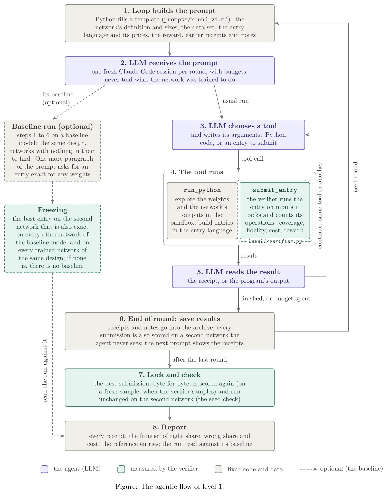
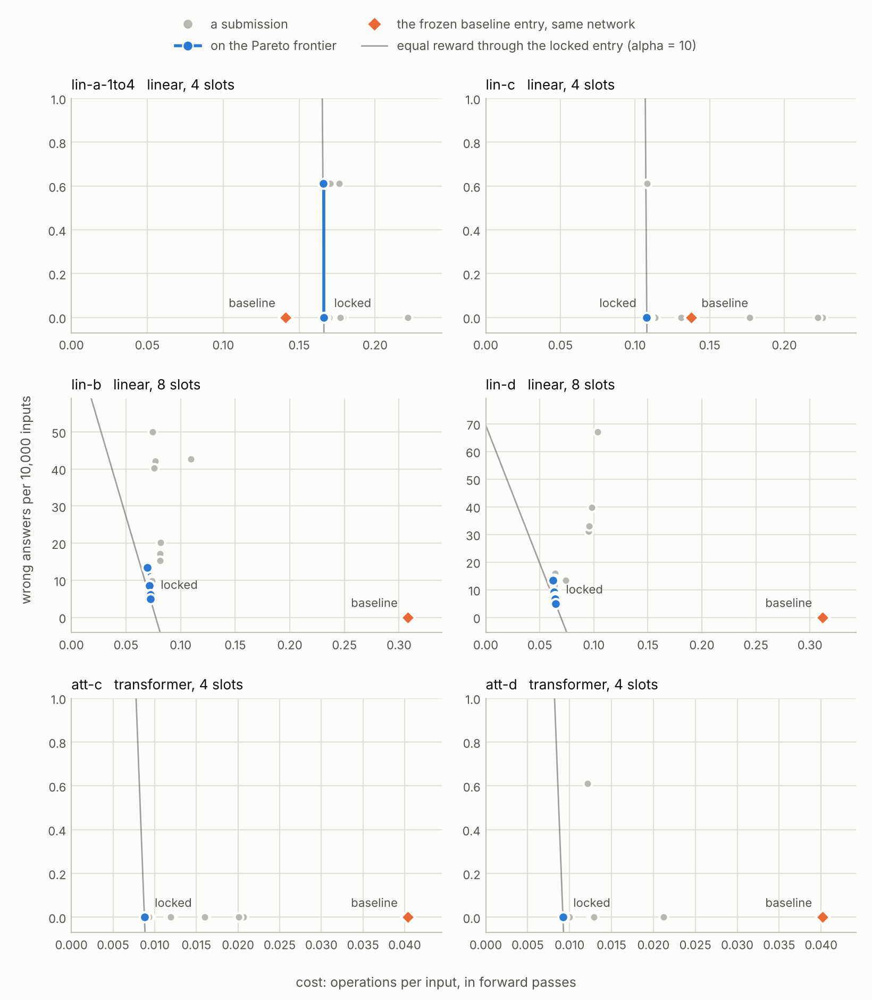

# Mech-Interp-Agent-level1

## Big picture

In this repo we consider an automated, agentic hill-climbing approach to mechanistic understanding.
This is a setup in which an agent proposes an interpretation $I$ of a network, a verifier scores
it, and the agent climbs that score round after round. While this is formalised in the next
section, we may think of an interpretation as a description of the network that predicts the
network's outputs more cheaply than running it. This is in line with the bottom-up approach of ARC,
where explaining a network means estimating its behaviour mechanistically, by reasoning from its
weights rather than from samples of its outputs, and where such an estimate should compete with
random sampling ([ARC progress update: Competing with sampling](https://www.lesswrong.com/posts/XdQd9gELHakd5pzJA/arc-progress-update-competing-with-sampling)).
Hence the interpretation should be more accurate than any method of the same cost that only runs
the network as a black box, such as running it on a random share of the inputs.

## More formally

We have a model $M$ and a data set $D$, a distribution over the inputs of $M$. An interpretation
$I$ is a program that maps an input $x$ to a predicted output $I(x)$ without running $M$. It is
written in a small language of priced operations ([`agent_docs/ENTRY.md`](agent_docs/ENTRY.md)), in
which $M$ itself is written too, so that both are priced by the same list. We may think of an
interpretation claim as a triple $(I, S, p)$: the interpretation $I$; the region $S$, the inputs it
is claimed for, given by a test on the input in the same language; and the claimed fidelity $p$.
In the code the pair $(S, I)$ is called an entry, and $p$ is handed in with it. A claim is judged
by three metrics:

- **Coverage** $\mu = P(x \in S)$, for $x$ drawn from $D$: how much of the data set the claim
  covers.
- **Fidelity** $q = P(I(x) = M(x) \mid x \in S)$: how often, on the region, the interpretation
  gives the network's output.
- **Cost** $c$, the length of the computation: the operations the claim spends (the interpretation
  on $S$, the region test on every input, and whatever it computes once from the weights), per
  input of $S$, in forward passes of $M$. The network itself has $c = 1$.

The verifier measures all three on inputs it draws from $D$, or on all of them when they are few.
Nothing is proved: a claim is checked by measuring it.

## Reward function

### What we use

Each claim gets one number from what the verifier measured. With $\mu$ the coverage, $c$ the cost
and $q_{\text{low}}$ the lower end of the fidelity's 95% interval on the sample (the fidelity itself
when every input is checked):

```math
R = \mu \, \big[ (1 - c) - \alpha \, (1 - q_{\text{low}}) \big], \qquad \alpha = 10
```

Read it for one input of the region: answering it with the interpretation instead of the network
saves $1 - c$ of a forward pass, and a wrong answer is charged $\alpha$ forward passes. Multiplied
out over the $n$ inputs scored, with $F$ the operations of one forward pass and the measured
fidelity in place of its lower bound:

```math
R = \mu - \frac{\text{operations spent}}{n F} - \alpha \, \frac{\text{wrong answers}}{n}
```

In units of $1/n$: every input covered earns 1, every operation costs $1/F$, and every wrong answer
costs $\alpha$.

- **The network itself scores 0**: $\mu = q = c = 1$. An input on which the network itself is run
  earns nothing, so a positive score has to come from computing less than the network does.
- **1 is the most**: right on every input at no cost. On a sample of 16,384 inputs the lower bound
  caps it at about 0.998.
- **Errors are expensive**: a claim gains only where $q > 1 - (1 - c)/\alpha$, so at $\alpha = 10$
  it must be right more than 90% of the time even if it is free. $\alpha$ must exceed 1: at
  $\alpha = 1$ the reward is $q - c$, and a free constant guess, right on 1 input in 64, would beat
  the network.
- **It adds up over the data set**: an input left out of the region earns 0, the same as an input on
  which the network itself is run, so a claim's score is the sum of what its parts earn.
- **As a speed-up**: run the network wherever the claim does not apply and count each wrong answer as
  $\alpha$ forward passes. Then $R$ is 1 less the compute with the claim over the compute without it,
  and $1/(1 - R)$ is the speed-up: 0.99 is about a hundredfold.
- **The frontier needs no $\alpha$**: the reports also mark the Pareto frontier of right share, wrong
  share and cost; $R$ picks one point on it.

Rewards are functions in `level1/rewards.py`, chosen by the run config. Every receipt keeps the
measured parts, so a finished run can be scored again under another reward
(`python -m level1.loop rescore`), and a new reward has to give the network itself 0.
`docs/REWARD.md` has the details and the ways a reward can be gamed.

### Louis's suggestion

```math
\text{score} = \begin{cases} \mu \, p & \text{if } \hat q \ge p \\ \mu \, \big(\hat q - \lambda \, (p - \hat q)\big) & \text{otherwise} \end{cases}
```

## Agentic setup / Auto-research



## Results

### Overall

In the following experiments we will now use the agentic setup from above to analyse different
models. While our goal is "heuristic understanding", naturally the "reward function" merely evaluates
how well the agent can "predict" the output. Hence, we expect that part of the hill-climbing will
amount to inference optimisation in a sense. For that reason we always compare to a baseline of the
agent working on the same architecture with nothing learned in it, i.e. a random baseline: networks
drawn the way training starts (the same distribution of starting weights, other seeds) and kept as
drawn. Its agent is asked for an interpretation exact for any weights, which counts only if it is
exact on four more such networks, so it cannot rely on the particular draw; only its cost depends on
the weights.

### Experiment 1: evaluation on training inputs only

#### Model

Linear max4. Each of the 64 tokens has an embedding column of 8 numbers; the columns of an input's
four tokens are added up and multiplied by a hidden 8 x 8 matrix and an unembedding to 64 logits, and
the output is the argmax. There is no nonlinearity and no position. It was trained to output the
largest of the four tokens, on fresh uniformly random inputs of exactly four tokens at every step
(cross-entropy, AdamW, batch 1,024), until its accuracy stopped rising. There are two networks, from
two seeds; they give the largest token on about 99.8% of all 64^4 inputs.

#### Results

Linear max4 asked only about its training inputs, every input of four tokens. The three metrics and
the reward, on 16,384 sampled inputs of each network:

| Entry | Network | Coverage | Fidelity | Wrong of 16,384 | Cost | Operations per input | Reward |
| --- | --- | ---: | ---: | ---: | ---: | ---: | ---: |
| The network itself | either | 1 | 1 | 0 | 1 | 671 | -0.0023 |
| The run's locked entry | first | 1 | 0.99872 | 21 | 0.0064 | 4.3 | 0.9740 |
| The run's locked entry | second, held out | 1 | 0.99921 | 13 | 0.0064 | 4.3 | 0.9800 |
| The baseline's frozen entry | first | 1 | 1 | 0 | 0.1737 | 116.6 | 0.8239 |
| The baseline's frozen entry | second, held out | 1 | 1 | 0 | 0.1705 | 114.4 | 0.8272 |

The Pareto frontier of right share, wrong share and cost, on the same inputs. First network:

| Interpretation | Right share | Wrong share | Cost | Reward | On the frontier |
| --- | ---: | ---: | ---: | ---: | --- |
| The network itself | 100% | 0% | 1 | -0.0023 | no |
| Plain algebra: the three matrices multiplied once | 100% | 0% | 0.4788 | 0.5188 | no |
| The baseline's frozen entry | 100% | 0% | 0.1737 | 0.8239 | yes |
| The largest token | 99.823% | 0.177% | 0.0045 | 0.9701 | yes |
| The largest token, floored at 10 (the run, round 1) | 99.872% | 0.128% | 0.0060 | 0.9745 | yes |
| The largest token, floored from the weights (the run, locked) | 99.872% | 0.128% | 0.0064 | 0.9740 | no |

Second network, held out:

| Interpretation | Right share | Wrong share | Cost | Reward | On the frontier |
| --- | ---: | ---: | ---: | ---: | --- |
| The network itself | 100% | 0% | 1 | -0.0023 | no |
| Plain algebra: the three matrices multiplied once | 100% | 0% | 0.4788 | 0.5188 | no |
| The baseline's frozen entry | 100% | 0% | 0.1705 | 0.8272 | yes |
| The largest token | 99.847% | 0.153% | 0.0045 | 0.9730 | yes |
| The largest token, floored at 10 (the run, round 1) | 99.847% | 0.153% | 0.0060 | 0.9715 | no |
| The largest token, floored from the weights (the run, locked) | 99.921% | 0.079% | 0.0064 | 0.9800 | yes |

### Experiment 2

#### The models and what we did

Every pilot network reads a row of slots (4, or 8 for linear max4 and min4), each holding one of 64
tokens or nothing, and outputs one of the 64 tokens. Each model has two networks, trained by the same
recipe from two seeds. The names below are ours, for reading the results; in the repository and for
the agent the models are folders with names that say nothing (second column).

| Model | In the repository | Architecture | Trained to output | Trained on | Asked about |
| --- | --- | --- | --- | --- | --- |
| linear max2 | lin-a-1to4 | linear | the largest token | exactly 2 tokens | 1 to 4 tokens |
| linear min2 | lin-c | linear | the smallest token | exactly 2 tokens | 1 to 4 tokens |
| linear max4 | lin-b | linear | the largest token | exactly 4 tokens | 1 to 8 tokens |
| linear min4 | lin-d | linear | the smallest token | exactly 4 tokens | 1 to 8 tokens |
| att max4 | att-c | transformer | the largest token | exactly 4 tokens | 1 to 4 tokens |
| att min4 | att-d | transformer | the smallest token | exactly 4 tokens | 1 to 4 tokens |

- **Linear**: each token has an embedding column of 8 numbers (an empty slot's is zero). The columns
  of an input's tokens are added up and multiplied by a hidden 8 x 8 matrix and an unembedding to 64
  logits, and the output is the argmax. There is no nonlinearity and no position, so the output
  depends only on which tokens occur. The four differ only in their task (largest or smallest) and
  in how many tokens they were trained on (2 or 4).
- **Transformer**: one layer with one attention head and nothing else (no MLP, no layer norm, no
  biases), width 32, with learned position embeddings; it is read at the last token given, attending
  over the tokens given. att max4 and att min4 differ only in their task.
- **Where they come from**: linear max2's networks and att max4's are the proof pipeline's (the
  setting of Gross et al.); linear min2 and att min4 were trained here by the same recipes, and linear
  max4 and min4 by the same recipe for longer, until their accuracy stopped rising. Every one follows its task on 99.7% to
  99.99% of its training inputs.

**What we did.** Each network is asked about more inputs than it was trained on: every number of
tokens from 1 up to its slots, each number equally likely (about 17 million inputs with 4 slots,
2.8 x 10^14 with 8). Off its training inputs a network does something other than its task, and
differently for each seed: att max4's first network gives the largest token on 17% of 3-token inputs,
its second on 98%. The agent is told the data set in full, but never the task or the training
inputs, so finding where a network's behaviour can be described cheaply is the work. It works on the
first network for at most 5 rounds of at most 4 submissions (`claude-fable-5-1` at effort high,
16,384 inputs per scoring, r_alpha with alpha = 10), and its best entry is then locked and run
unchanged on the second network. For each design an agent also made one run on networks of the same
shape with nothing learned in them, the baseline (13 November). The recurrent models, not run yet,
and the baseline models are described in [`withheld/README.md`](withheld/README.md).

**The reward scale.** 0 is the network itself, and 1 an entry that is always right and costs
nothing; on a sample of 16,384 inputs the most an entry can score is about 0.998, because the reward
uses the lower end of the fidelity's interval. Below 0, an entry's wrong answers cost more than it
saves. With the network run wherever an entry does not apply, and each wrong answer counted as ten
forward passes, an entry of reward R costs 1 - R of running the network on everything: 0.83 is about
a sixfold saving, 0.99 about a hundredfold.

#### The runs

| Model | Asked about | F | Locked | Fresh sample | Second seed |
| --- | --- | ---: | ---: | ---: | ---: |
| linear max2 | 1 to 4 tokens | 671 | 0.8314 | 0.8310 | 0.8298 |
| linear min2 | 1 to 4 tokens | 671 | 0.8898 | 0.8900 | 0.8893 |
| linear max4 | 1 to 8 tokens | 703 | 0.9180 | 0.9129 | 0.8027 |
| linear min4 | 1 to 8 tokens | 703 | 0.9257 | 0.9128 | 0.8301 |
| att max4 | 1 to 4 tokens | 12,987 | 0.9889 | 0.9887 | 0.9905 |
| att min4 | 1 to 4 tokens | 12,987 | 0.9884 | 0.9884 | 0.9871 |

- **F**: the operations of one forward pass, by the price list.
- **Locked**: the reward of the run's best submission on its own network, as scored when it was
  submitted. It is the best of several scorings, so it leans high.
- **Fresh sample**: the locked entry scored again on the same network, on a fresh sample.
- **Second seed**: the locked entry, unchanged, on a network of the same design and training with
  another seed, which the agent never sees.

#### Against their baselines

How a baseline is made, frozen and read is under "The baseline" in More implementation details.
Each baseline run froze an entry that gave the network's output on every checked input of all four
of its model's other networks, so all three baselines are established:

| Baseline run | Serves | Frozen entry | On its second network | On its other four networks |
| --- | --- | --- | ---: | --- |
| linear, 4 slots (pilot-lin-e-exact) | linear max2, linear min2 | r5s3 (ts4) | 0.8388 | 0.838 to 0.842, exact on each |
| linear, 8 slots (pilot-lin-f-exact) | linear max4, linear min4 | r3s1 (tri_v3) | 0.6888 | 0.687, exact on each |
| att, 4 slots (pilot-att-e-exact) | att max4, att min4 | r3s2 (v3g) | 0.9735 | 0.977 to 0.990, exact on each |

Each run read against its baseline, every number on the run's own inputs: R0 is the locked entry on
its fresh sample, R1 in the seed check, and B0 and B1 the frozen entry on the same inputs. The three
parts add up to R0. In brackets, the range when each fidelity moves across its 95% interval, as the
report gives it.

| Model | R0 | Baseline B0 | Kept on the held-out network, R1 - B1 | Gap, (R0 - B0) - (R1 - B1) |
| --- | ---: | ---: | --- | --- |
| linear max2 | 0.8310 | 0.8565 | -0.026 (-0.028 to -0.023) | +0.001 (-0.005 to +0.005) |
| linear min2 | 0.8900 | 0.8601 | +0.029 (+0.027 to +0.031) | +0.001 (-0.004 to +0.006) |
| linear max4 | 0.9129 | 0.6894 | +0.113 (+0.110 to +0.144) | +0.111 (+0.077 to +0.122) |
| linear min4 | 0.9128 | 0.6861 | +0.139 (+0.136 to +0.168) | +0.088 (+0.056 to +0.103) |
| att max4 | 0.9887 | 0.9573 | +0.033 (+0.031 to +0.036) | -0.002 (-0.006 to +0.003) |
| att min4 | 0.9884 | 0.9575 | +0.030 (+0.028 to +0.032) | +0.001 (-0.004 to +0.006) |

The kept part is the run's lead over the baseline on a network its agent never saw. The gap is the
part of the lead that holds on the run's own network and not on the held-out one: whatever was
fitted to the first network, or sampling noise.

#### The Pareto frontier

Every submission covered the whole data set, so its right share is one less its wrong share, and
the frontier of three numbers is a frontier of two: cost against wrong answers. Each panel is one
run on its own network: every scored submission, the ones on the frontier (joined), the locked
entry, and the frozen baseline entry scored on the same network. The grey line is equal reward
through the locked entry: with alpha = 10, one wrong answer in 10,000 inputs weighs as much as 0.001
of cost, so the line stands nearly upright wherever wrong answers are rare. Every submission is
scored on its own sample, so one entry submitted twice can show twice. Each run's report lists its
frontier with the numbers, and `docs/figures/frontier.py` draws this from the run folders.



- On att max4, att min4 and linear min2 one exact entry is the whole frontier: it is also the cheapest, so
  alpha decides nothing there.
- On linear max2 the baseline's entry lies left of the whole frontier: exact, and cheaper than
  anything the run submitted.
- On linear max4 and min4 the frontier trades cost for a few wrong answers, and alpha = 10 picks the
  locked entry on it; the baseline's entry is exact but more than four times as costly. There, two
  scorings of one entry differ about as much as different entries do.

#### What they show so far

- Every locked entry beats the network by a wide margin, and the runs on 4 slots keep it on the
  second seed: there they are within 0.002 of the fresh sample.
- On the 4-slot linear design almost all of the score is generic. An agent that never saw a trained
  network found an exact entry worth 0.857 on linear max2's own network, more than that run's 0.831:
  a search that bounds blocks of outputs and computes exact logits only where one can still win,
  where the run used tables of pair sums. Linear min2's run keeps +0.03 over it.
- On the transformers the generic part is 0.957, and the runs keep +0.03 over it on networks their
  agents never saw, with no gap.
- On the 8-slot linear design the runs keep +0.11 and +0.14 over a weaker baseline (0.69; its agent
  found much less than the 4-slot one did), and lose 0.11 and 0.09 between their two networks.
  Their entries compute exact logits only for the outputs that can still win on long
  inputs, and which outputs those are was read off the first network.
- A frozen entry can score more on a trained network than on its own model's (the 4-slot linear
  baseline's: 0.857 on linear max2, 0.839 on its own second network): it is exact for any weights, but what it costs depends
  on them.
- The agents resubmit the same entry to draw a luckier sample, so the fresh sample is the number to
  compare.

Not run yet: linear max2, att max2 and att min2 asked only about pairs of tokens, their training
inputs (lin-a, att-a, att-b), and the recurrent networks.

## More implementation details

### The prompt

Every round is a fresh Claude Code session with one prompt, filled in from the template
`prompts/round_v1.md` by `level1/prompt.py`. The template names no model: everything about one comes
from its folder and the run config. The session has two tools and no others: the CLI's own tools are
turned off, and the two come from `level1/mcp_server.py`. In order, the prompt gives the agent:

1. **The task.** It is given a network's definition and weights, and is not told what the network
   was trained to do. An interpretation is a program that predicts the network's output from the
   input without running the network, handed in as an entry with the region it applies to. The aim
   is the highest reward.
2. **The network**: the source of `models/<name>/model.py`, which writes the network in the entry
   language, its sizes, and the operations of one forward pass.
3. **The data set**, in the words of the model's `data_set.says`.
4. **Entries**: the entry guide, `agent_docs/ENTRY.md`: the language, its prices and the builder.
5. **How an entry is scored**: coverage, fidelity and cost in words, the reward and how to read it,
   what the network itself scores, the sample and its lower bound, and the seed check. The locked
   entry will be run unchanged on a second network the agent never sees, and with every submission
   the agent states the fidelity it claims on this network and the one it expects on the second. A
   baseline run's prompt has one more paragraph here, asking for an entry exact for any weights.
6. **Tools, budgets and limits**: `run_python`, 40 calls a round of up to 300 seconds each;
   `submit_entry`, 4 submissions a round; an entry's limits, 400 nodes and 256 numbers in constants.
   (A round also stops after 90 minutes or 150 turns; the prompt does not say so.)
7. **Earlier rounds**: every earlier submission's receipt, and the notes each round left.
8. **What to send back**: the notes that end the round, under five headings: what the network does,
   how you found it, the best entry, claims, and next.

### Coverage, fidelity and cost, as the verifier computes them

An entry is JSON data: a list of nodes, each one operation on earlier nodes, whose sources are the
input's tokens, the network's weights by name, constants and ranges. Two nodes are its results:
`rule`, the region test, one boolean per input (absent: every input is in the region), and
`predict`, the interpretation, one whole number per input. The agent writes entries in Python with a
builder (`lv1.Graph`), but nothing of an entry is ever run as code: the verifier interprets the JSON
(`level1/lang.py`, `Evaluator`) and counts every operation by the price list `prices-v1`. An
elementwise result costs 1, a matrix product 1 per multiply-add, a reduction over n entries n - 1,
a sort n * ceil(log2 n), reading a number by index 1, and moving data (reshape, slice, concat) 0.
`cond(c, x, y)` computes only the chosen side and costs 1 on top of it; `where(c, x, y)` computes
both. The network itself is written in the same language (`models/<name>/model.py`), and one forward
pass costs it F operations, the same on every input.

The verifier (`level1/verifier.py`) picks n inputs: every input of the data set when it can be
listed (linear max2 asked only about pairs: 4,096 inputs), otherwise a sample drawn from D (16,384 inputs in the pilots), afresh
for each of the agent's submissions, from a seed nobody chose. It runs the network on them for its
outputs M(x), then the entry, with `lang.measure`:

```python
# level1/lang.py, measure(): one pass over the n inputs
for x, truth in zip(inputs, model_answers):     # model_answers: the network's outputs M(x)
    inside, answer, c_rule, c_pred = ev.run(x)  # the region test, then the interpretation if inside
    rule_ops += c_rule                          # the region test is paid for on every input
    if inside:
        inside_n += 1
        predict_ops += c_pred                   # the interpretation only on the region
        agree += int(answer == int(truth))
coverage = inside_n / n
fidelity = agree / inside_n
cost = (predict_ops + rule_ops + ev.build_cost) / (inside_n * model_ops)
```

- **Coverage** is `n_in_region / n_inputs`, the share of the inputs scored on which the region test
  is true.
- **Fidelity** is `n_agree / n_in_region`, the share of the region on which the interpretation's
  output equals the network's output exactly: agreement of outputs, not of distributions. On a
  sample the verifier also records `fidelity_low`, the lower end of the 95% Wilson interval for
  `n_agree` successes in `n_in_region` draws (`lang.wilson_lower`, z = 1.96), and the reward uses it,
  so that a lucky sample does not pay. When every input is checked, `fidelity_low` is the fidelity.
- **Cost** is everything the entry computed, per input of its region, in forward passes. A node that
  does not depend on the input is computed once, the first time it is needed, and counted once, in
  `build_ops`. The rest is counted per input: the region test on every input, the interpretation on
  the inputs of the region, and a value the region test already computed for an input is not counted
  again. The receipt keeps three parts, `r = predict_ops / (n_in_region * F)`,
  `r_rule = rule_ops / (n_inputs * F)` and `b = build_ops / (n_inputs * F)`, so that
  `cost = r + (r_rule + b) / coverage`. The build is spread over the inputs scored.

Every receipt keeps these counts and parts, so a run can be scored again under another reward
without running anything. With the entry the agent also states a claimed fidelity; the receipt
records it and the overclaim, the claim minus the measured fidelity when positive. An entry may have
at most 400 nodes and 256 numbers in constants, so a table of the network's outputs cannot be
written into it; a table computed from the weights in the build is allowed, and paid for there. The
verifier gives an entry 120 seconds on its inputs.

### Checking what the agent did

Nothing the agent says is taken on trust: what it did is recorded, fenced in and checked.

- **Before any model is asked**, the hygiene check (`level1/hygiene.py`) searches everything the
  agent can reach (the prompt, the tools' descriptions, the files in its sandbox, names) for the
  words in `withheld/<model>/task.yaml` that would say what the network does, and stops the run on a
  hit.
- **Everything is recorded as it happens**: each round's prompt and the agent's answer, every tool
  call with its result, every program it ran with what it printed, the CLI's whole stream (the
  agent's text between its tool calls included) and every receipt (see "What a run writes"). Each
  round ends with notes under fixed headings: what the network does and on which inputs, how that
  was found (the outputs, the weights, or both), the best entry and where its saving comes from,
  the claims, and what to try next. The next round knows only these notes and the receipts.
- **The agent's code runs in a sandbox.** A guard inside Python refuses files outside the
  program's folder, sockets, other processes, signals and native code, and writes every refusal to
  the program's audit record. The guard shares a process with the code it watches, so for a run that
  counts the system's own sandbox is the wall: `seatbelt` on a Mac, a container or Landlock on
  Linux. Every run starts with a probe that tries real escapes, with and without the guard (reading
  the verifier, the second network's weights and the withheld task file in several ways, writing
  outside the folder, opening connections), and judges them by evidence outside the sandbox
  (`docs/SANDBOX.md`).
- **The report audits every round**: how many programs ran and for how long, every attempt the
  guard refused, every program whose text reaches for files or the system (`open(`, `os.`,
  `subprocess`, sockets, `eval`, the word withheld and others, `report.REACHES`), and every program
  whose audit record is incomplete.
- **Entries are data, not code.** The verifier interprets them, so an entry can do no work that is
  not counted and can read nothing but the input and the weights of the network it is scored on. The
  locked entry is the submission byte for byte; its hash is checked.
- **Claims are set against measurements.** With every entry the agent states the fidelity it
  expects on this network and on a second network; both are kept next to what is measured. Every
  submission is also scored on the second network after its round, on one fixed sample, and the
  agent never sees those scores (`seed_scores.jsonl`): they show round by round whether its entries
  drift towards the first network's quirks.

In the nine runs so far the guard refused nothing, the probe got nothing out of the seatbelt
sandbox, and no claimed fidelity was above the measured one by more than 0.0013. Two early pilots
ran in process mode, linear max4 with the guard and linear max2 before the guard existed; linear max2's 52
programs were read by hand. The notes are the agent's own words: the measurements check the entries
built on them, not the words.

### The baseline

Much of what an entry saves can come from the algebra of the architecture alone: the forward pass
repeats the same products for the same token in the same slot, and tables computed once from the
weights remove that on any network of the design. The baseline measures that part, so that a run can
be read against it (`level1/baseline.py`, `docs/DESIGN.md` section 10).

- **Baseline models.** `lin-e`, `lin-f` and `att-e` have the design, sizes and data set of linear
  min2, linear min4 and att max4 (and so also serve linear max2, linear max4 and att min4), and `rnn-d`, `rnn-e` and `rnn-f`
  those of rnn-a, rnn-b and rnn-c. Their networks have nothing in them for an agent to find; what
  they are is in `withheld/<name>/`. The first network is for the rounds, the second for the seed
  check, the others for freezing.
- **A baseline run** is a usual run on a baseline model, under the same conditions as the runs it
  serves (prompt, rounds, budgets, entry limits, verifier, reward and prices: `baseline.CONDITIONS`),
  with one more paragraph in its prompt (`prompt.EXACT_NOTE`, run config `exact_on_any_weights`):
  its entries will also be run on other networks of the design, and count only if they are exact on
  all of them. A test checks that its first prompt and a twin run's are the same, byte for byte, but
  for that paragraph.
- **Freezing.** When the baseline run ends, its submissions that gave the second network's output on
  every input of their region are taken in the order of their reward there, one per different entry,
  and each is scored on every other network of the baseline model, on one fresh sample. The first
  that gives each of them the network's output on every input of its region is frozen
  (`baseline.json`, `baseline_entry.json`), and the baseline is established. If none of the first
  three does, it is not established, and no run is read against it.
- **Reading a run against it.** The frozen entry is scored on the run's network and on its second
  network, on the very inputs of the run's own scorings of its locked entry (the fresh sample and
  the seed check). With R0 and R1 the locked entry's rewards there and B0 and B1 the frozen
  entry's, the report splits R0 into three parts:

      R0 = B0 + (R1 - B1) + [(R0 - B0) - (R1 - B1)]

  the baseline on the run's network, the excess kept on the held-out network, and the gap between
  the two networks. Negative values are kept. It is accounting, not a causal split: the excess can
  hold generic tricks the baseline run did not find, and the gap can be sampling noise.
- **Why exactness.** The first baseline runs (pilot-att-e and pilot-lin-e), made without that
  paragraph, fitted their entries to their own networks: pilot-lin-e's were right on 74% to 81% of
  the other networks' inputs, and pilot-att-e's on about a third of a trained network's. A run's
  score read against them said nothing, so they serve no run.

## Getting started

### Install

    python -m venv .venv && source .venv/bin/activate
    pip install -r requirements.txt
    python -m pytest                      # about a minute; no model is called
    python -m level1.sandbox info         # which sandbox modes work on this machine

Use a virtual environment of this repository's own. Outside a container, the hygiene check also
reads the path of the Python that runs the agent's code, because a traceback shows that path to the
agent: an environment that lives in a folder named after the proof pipeline is refused.

Rounds run under your own Claude Code login, so the CLI (`claude`) has to be installed and signed
in. To bill an API key instead, see "On an API key" below.

### Run a pilot

Each model has a run config, `config/pilot/<name>.yaml`, and a small smoke config next to it,
`config/pilot/<name>-smoke.yaml`. First a dry run, with scripted rounds in place of a model (two
minutes):

    python -m level1.loop run --config config/pilot/lin-a-1to4.yaml --fake tests/fake_run_1to4 --run-id dry-run

Then the smoke run, one short round, to see that the login, the tools, the sandbox and the verifier
work together on this machine:

    python -m level1.loop run --config config/pilot/lin-a-1to4-smoke.yaml

Then the pilot proper, at most 5 rounds of up to 90 minutes each:

    python -m level1.loop run --config config/pilot/lin-a-1to4.yaml

If it stops (a usage limit, a dropped connection, a closed laptop), continue where it stopped:

    python -m level1.loop resume --run ~/mech-interp-level1-runs/pilot-lin-a-1to4

The pilot on pairs runs the same way with `lin-a-smoke.yaml`, `lin-a.yaml` and `tests/fake_run`, and
`tests/fake_run_any` is one scripted round that fits every model. Run folders live outside the
repository, in `~/mech-interp-level1-runs/<run_id>/` by default. On a Mac, run a long pilot under
`caffeinate -is`, with the lid open and on power: a session whose machine sleeps loses its prompt
cache and pays to write it again.

### With its baseline

A run is read against the baseline of its shape when one is frozen (`docs/DESIGN.md`, section 10).
Three ways to start:

    python -m level1.loop run --config config/pilot/att-c.yaml                   # the run only
    python -m level1.loop baseline --config config/pilot/att-c.yaml              # its baseline only
    python -m level1.loop run --config config/pilot/att-c.yaml --with-baseline   # both, side by side

A baseline is made once for a shape and its conditions and serves every run that matches; a
finished run gets one with `python -m level1.loop baseline --run <run folder>`. Each command takes
the same `--sandbox`, `--auth` and `--budget-usd` as `run`. The baseline models' own pilot configs
make runs named `pilot-<name>-exact`; baseline runs made before their prompt asked for an exact
entry serve no run.

### On an API key

A run can be billed to an API key instead of your login (`auth: api_key` in the run config, or
`--auth api_key` with any config). Put the key in `CPL_ANTHROPIC_KEY`, never in `ANTHROPIC_API_KEY`,
for example by loading the file you keep it in; `CPL_ANTHROPIC_WORKSPACE` takes a workspace ID if
the key is not scoped to one workspace. Then

    python -m level1.loop run --config config/pilot/lin-b-api.yaml --sandbox seatbelt

Before the first round the key is checked against the API's list of models, which costs nothing.
The run has a budget, by Claude Code's own count: `budget.run_usd` for the run (60 dollars) and
`budget.round_usd` for one round (20). Every session starts with what is left as its cap. A round
that reaches its cap ends with what it submitted; the rounds end when the run's budget is spent.
Claude Code checks its spending after every answer, so a session can go over its cap by one answer.
The run folder's `spend.jsonl` has every session's cap and cost. A session that reported no cost
counts at its cap; one the loop never saw end (the loop was killed) counts in the run's total only,
so its round gets its whole budget again when resumed. To go on with more:

    python -m level1.loop resume --run ~/mech-interp-level1-runs/pilot-lin-b-api --budget-usd 90

The CLI's `--bare` mode, which this uses, reads no login, so an API run cannot draw on a
subscription, and a login run cannot bill a key: the CLI's first event says what it billed, and a
session that does not fit stops the run.

### The sandbox

In every mode a guard inside Python refuses the agent's code files outside its folder, the network
and other programs, and records every attempt; the report lists them. The guard shares a process
with the code it watches, so for a run that is meant to count add `--sandbox hardened` (Docker or
Linux) or, on a Mac, `--sandbox seatbelt`. Try a mode first with the probe, which tries to escape
it and reports (`docs/SANDBOX.md`):

    python -m level1.sandbox probe --model models/lin-a --mode seatbelt

### Other commands

    python -m level1.loop finish --run <run folder>              # lock, seed check and report again; scores
                                                                 # any submission not yet on the second network
    python -m level1.loop rescore --run <run folder> --alpha 1   # the records under another reward
    python -m level1.report --model models/lin-a --alpha 1       # the reference entries under a reward
    python -m level1.report --model models/lin-a-1to4 --sample-size 16384
    python -m level1.verifier --model models/lin-a --network lin-a-s0 --entry entry.json
    python -m level1.verifier --model models/lin-a --network lin-a-s0 --entry entry.json --check sample
    python -m level1.sandbox build                               # the container image, if Docker runs
    python -m level1.sandbox probe --model models/lin-a          # try to escape the sandbox, and report

### What a run writes

Everything is written as it happens, so a run can stop and resume, and can be read afterwards:

- every prompt (`round_k/prompt.md`) and the agent's answer (`response.md`);
- every tool call with its result (`session/tools.jsonl`);
- every program the agent ran, in full, with what it printed (`session/python/NNN.py`, `.txt`),
  and what the guard refused it (`NNN.audit.json`);
- everything the CLI emitted, the agent's text between its tool calls included
  (`round_k/stream_NN.jsonl`);
- every submission's receipt, with the parts measured;
- every scored submission on the second network (`seed_scores.jsonl`);
- billed to an API key, every session's cap and cost (`spend.jsonl`);
- the report: `report.md` and `report.json`.

### Repository layout

    level1/            the pipeline
      lang.py          the entry language: operations, prices, the interpreter, the builder, data sets
      verifier.py      measures an entry; the only judge
      rewards.py       reward functions
      networks.py      model folders: the networks, the network written as an entry, what the agent is given
      prompt.py        a round's prompt
      session.py       one agent session: the two tools, budgets, log
      mcp_server.py    the session's tools as an MCP server, for the Claude Code CLI
      loop.py          rounds, lock, seed check; the command line
      baseline.py      the baseline of a run's shape: found, run, frozen, and a run read against it
      report.py        the report; the reference entries under any reward
      hygiene.py       the check that the agent is not told what the model does
      backends/        who answers a round: claude_code, fake
      budget.py        what a run billed to an API key may spend, and what it has spent
      run_config.py    run configs: defaults, then what a config extends, then the config
      sandbox.py, runner.py, harness.py    where the agent's code runs
      util.py          small helpers
    models/lin-a/           linear max2, asked only about pairs of tokens
    models/lin-a-1to4/      linear max2: the same two networks, asked about inputs of 1 to 4 tokens
    models/lin-b/           linear max4, asked about inputs of 1 to 8 tokens
    models/lin-c/, lin-d/   linear min2 and linear min4
    models/att-a/ .. att-d/   att max2, att min2 (2 slots), att max4, att min4 (4 slots)
    models/lin-e/, lin-f/, att-e/   baseline models of the shapes of linear min2, linear min4 and att max4
    models/rnn-a/ .. rnn-c/   one-layer ReLU recurrent networks on 2, 3 and 10 real numbers, five seeds each
    models/rnn-d/ .. rnn-f/   their baseline models
    withheld/<model>/       what it was trained to do, and reference entries (never shown to the agent)
    withheld/rnn/           where the recurrent networks come from: the original files and the converter
    agent_docs/        the entry guide the agent reads
    prompts/           the round's prompt template
    config/            defaults, the pilots' run configs and their small smoke runs
    sandbox/           the container image (Dockerfile)
    tests/             the tests, with each known way to game the score as a test
    docs/              DESIGN.md, REWARD.md, SANDBOX.md; figures/: the flow diagram, the frontier figure and their sources

`CLAUDE.md` has the working rules for changing this repository.
